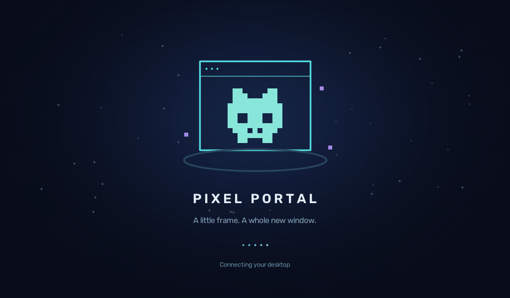

# v100-usb-display

Turn a cheap **Actions "V100" (ATJ2273F) digital photo frame** into a real **1024×600 USB secondary monitor** for Windows.

No hardware modification, no soldering. The frame's own boot ROM has a USB recovery mode (ADFU); this project uploads a tiny bare-metal program
into the frame's RAM over that mode, streams your desktop to it over the mini-USB cable, and shows it on the panel as an extended Windows desktop
(~30 fps, native resolution, 12-bit colour).

> **Status: v0.1, works on exactly one verified unit** (see [docs/HARDWARE.md](docs/HARDWARE.md)). If your frame has the same USB IDs it *may* work;
> please report what you find. Nothing in the default setup writes to the frame's flash: unplugging it restores stock behaviour.
>
> **Not sure your frame is the same?** Follow [the checklist for other frames](docs/HARDWARE.md#trying-a-frame-that-is-not-the-verified-unit) and plug it in **while holding MENU** the first time:
> that uses only the chip's built-in recovery mode. The automatic mode switch (no button needed) sends one undocumented vendor command to the frame's normal firmware,
> which is known to be fine on the verified unit but untested on others.
> The install itself was tested on a clean Windows 11 VM; the plug-in step is verified only on the one real frame.

## What you get

- Plug the frame in → it appears as an additional Windows display (1024×600, 30 Hz) after ~10 s; drag windows onto it. Unplug → it disappears.
- A boot/loading picture shown from the first ~2 s until the desktop appears (default artwork included; you can use your own):

  

- Native 1024×600, text stays sharp; colour is dithered RGB444 (4096 colours) decoded to the panel's RGB565.
- Everything runs from the frame's RAM. The frame's flash is untouched unless you opt in to the [guarded flash tools](flash/README.md).

## How it works (short)

```
Windows desktop ── virtual display (signed VDD driver) ──▶ capture ──▶ 12-bit packer ──▶ USB bulk ──▶ frame
                                                                                           │
frame boot ROM (ADFU) ◀── stage-1 stub (2 KB, panel/LCD init, USB receiver, "load blob" command)
                      ◀── stage-2 blob (DMA from the USB FIFO + 12-bit decoder running from the I-cache)
```

The long version, with the measurements that shaped the design (366 MIPS from the I-cache vs 17 MIPS uncached, the USB FIFO port ceiling, DMA findings)
is in [docs/ARCHITECTURE.md](docs/ARCHITECTURE.md).

## Requirements

- Windows 10/11 with **WSL2** and **usbipd-win** (the frame's USB device is driven from Linux user space through usbipd; a native-Windows path is on the roadmap)
- Python 3.10+ for Windows
- The frame, a mini-USB cable, a free USB 2.0 port (the frame is a USB 2.0 high-speed device; USB 3 ports work as USB 2)
- The signed [Virtual Display Driver](https://github.com/VirtualDrivers/Virtual-Display-Driver) 25.7.23 (MIT) — you download it yourself, `setup.ps1` verifies it against pinned SHA-256 values

## Quick start

0. `git clone https://github.com/amy-25flip/Photo-Frame-Wired-Display.git` and open a terminal in the folder.
1. Install prerequisites: `wsl --install`, `winget install --exact dorssel.usbipd-win`, Python for Windows.
2. Download the VDD "Driver Only" release asset 25.7.23 and unzip it somewhere.
3. In an **elevated** PowerShell:
   ```powershell
   powershell -ExecutionPolicy Bypass -File windows\setup.ps1 -DriverDir C:\path\to\VDD
   ```
4. Start the watcher (or `windows\autostart.ps1` to start it at sign-in):
   ```powershell
   python v100display\frame_watcher.py
   ```
5. Plug the frame in. Do **not** hold MENU (holding MENU also works, it just skips the automatic mode switch).

Optional tuning (backlight brightness, CPU clock) lives in `v100display/settings.json`, see [docs/SETUP.md](docs/SETUP.md#5-optional-tuning-settingsjson).

Windows will ask once whether to install the display driver from *SignPath Foundation*: choose Install. Run `wsl --install` in a normal interactive window.
Details and troubleshooting: [docs/SETUP.md](docs/SETUP.md), [docs/TROUBLESHOOTING.md](docs/TROUBLESHOOTING.md).

## Use your own boot picture

`python v100display\set_boot_image.py picture.jpg` converts any picture into the loading picture (restore the original with `--restore`).
To store a picture *inside the frame* so it shows even from a clean checkout, see the optional [flash tools](flash/README.md).

## Safety

- The default mode only writes to the frame's **RAM**. A power cycle always returns it to its previous state.
- The optional flash tools change the frame's firmware flash. They only act on a verified identical firmware image, refuse protected or unknown flash,
  require your own full backup first and verify every write — but **a flash write can brick a device**. Read [flash/README.md](flash/README.md) first.
- No warranty (GPL-2.0-or-later). This project is not affiliated with Actions Semiconductor.

## Repository layout

| path | what |
|---|---|
| `v100display/` | host software (watcher, capture, packer, loaders) and the generators of the two on-device programs (`stage1.py`, `s2_c444.py`) |
| `windows/` | one-time setup, autostart, uninstall, virtual-display installer |
| `flash/` | **optional, advanced**: boot patch (skip the stock splash) and "boot picture in flash" |
| `docs/` | hardware, setup, architecture, troubleshooting, reverse-engineering notes |
| `tests/`, `flash/tests/` | unit tests and MIPS-emulator tests of the on-device code (`python -m unittest discover -s tests`) |

## Contributing

Reports of other frames (USB IDs, board marking, flash ID, panel size) are the most valuable contribution right now — see
[docs/HARDWARE.md](docs/HARDWARE.md#reporting-a-different-frame). Pull requests welcome; please keep firmware dumps out of the repository.

## Credits and licence

GPL-2.0-or-later, see [LICENSE](LICENSE) and [NOTICE.md](NOTICE.md) (the ADFU loader this builds on, the register-map work by others, the virtual display driver).
